<a href="https://kian.my.id">
  <picture>
    <source media="(prefers-color-scheme: dark)" srcset="https://raw.githubusercontent.com/kianlabs/kianlabs/main/assets/header-dark.svg"/>
    
  </picture>
</a>

<div align="center">


<a href="https://github.com/kianlabs?tab=followers"></a>
<a href="https://kian.my.id"></a>

</div>

## <picture><source media="(prefers-color-scheme: dark)" srcset="https://raw.githubusercontent.com/kianlabs/kianlabs/main/assets/art/about-dark.svg"/></picture> Tentang Aku

```go
kyan := Developer{
    Name:     "Ridzkyan Buti Pratama (Kyan)",
    Location: "Kartasura, Sukoharjo 🇮🇩",
    Role:     "Web Developer",
    Education: Education{
        Degree: "S1 Teknik Informatika — Universitas Duta Bangsa Surakarta",
        GPA:    3.69,
        Thesis: "Klasifikasi keuangan UMKM (Gaussian Naive Bayes)",
    },
    Focus:    "Production projects + solid backend fundamentals",
    Learning: []string{"Go (Golang) backend", "Full Stack Development", "AI / Machine Learning"},
    Status:   "🎓 Fresh graduate Okt 2026 · 🟢 Open to work as Backend / Fullstack Developer",
}
```

> [!NOTE]
> Most of my recent work is in private client repositories — the projects below are my personal work.

## <picture><source media="(prefers-color-scheme: dark)" srcset="https://raw.githubusercontent.com/kianlabs/kianlabs/main/assets/art/stack-dark.svg"/></picture> Tech Stack

<div align="center">

<table>
  <tr>
    <td align="center" width="140"><b>Frontend</b></td>
    <td></td>
  </tr>
  <tr>
    <td align="center"><b>Backend</b></td>
    <td></td>
  </tr>
  <tr>
    <td align="center"><b>Database</b></td>
    <td></td>
  </tr>
  <tr>
    <td align="center"><b>DevOps &amp; Tools</b></td>
    <td></td>
  </tr>
  <tr>
    <td align="center"><b>Currently Learning</b></td>
    <td></td>
  </tr>
  <tr>
    <td align="center"><b>AI</b></td>
    <td>LLM API Integration · RAG · MCP · Prompt Engineering · AI Agent Orchestration</td>
  </tr>
</table>

</div>

## <picture><source media="(prefers-color-scheme: dark)" srcset="https://raw.githubusercontent.com/kianlabs/kianlabs/main/assets/art/projects-dark.svg"/></picture> Featured Projects

<table>
  <tr>
    <td width="50%" valign="top">
      <h3>☕ Rahardjo Finance</h3>
      <p>Finance &amp; inventory web app for a coffee shop (client work): shift reports, stock, weighted-average HPP, P&amp;L.</p>
      <p>
        
        
        
      </p>
      <a href="https://rahardjo-finance.pages.dev"></a>
    </td>
    <td width="50%" valign="top">
      <h3>🧾 Suro POS</h3>
      <p>Offline-first tablet POS for coffee shops: cashier, recipe-based stock, HPP per gram, Bluetooth printing.</p>
      <p>
        
        
        
        
      </p>
      <a href="https://github.com/kianlabs/coffee-shop-pos"></a>
    </td>
  </tr>
  <tr>
    <td width="50%" valign="top">
      <h3>💰 UangKu</h3>
      <p>Personal finance tracker (production) + Google OAuth, category budgets, PDF/CSV export.</p>
      <p>
        
        
        
        
      </p>
      <a href="https://uangku-web.my.id"></a>
      <a href="https://github.com/kianlabs/uangku"></a>
    </td>
    <td width="50%" valign="top">
      <h3>💼 GaweTracker</h3>
      <p>Realtime job discovery scraper (Glints &amp; JobStreet) and Kanban application tracker.</p>
      <p>
        
        
        
        
      </p>
      <a href="https://gawetracker.kianlabs.my.id"></a>
      <a href="https://github.com/kianlabs/gawetracker"></a>
    </td>
  </tr>
</table>

## <picture><source media="(prefers-color-scheme: dark)" srcset="https://raw.githubusercontent.com/kianlabs/kianlabs/main/assets/art/stats-dark.svg"/></picture> GitHub Stats

<div align="center">

<picture>
  <source media="(prefers-color-scheme: dark)" srcset="https://github-stats-extended.vercel.app/api?username=kianlabs&show_icons=true&hide=stars&hide_border=true&count_private=true&include_all_commits=true&bg_color=0d1117&title_color=00add8&icon_color=00add8&text_color=c9d1d9&ring_color=00add8"/>
  
</picture>
<picture>
  <source media="(prefers-color-scheme: dark)" srcset="https://github-stats-extended.vercel.app/api/top-langs/?username=kianlabs&layout=compact&hide_border=true&langs_count=8&hide=HTML&exclude_repo=belajar-programming&bg_color=0d1117&title_color=00add8&text_color=c9d1d9"/>
  
</picture>

<picture>
  <source media="(prefers-color-scheme: dark)" srcset="https://streak-stats.demolab.com?user=kianlabs&hide_border=true&background=0D1117&ring=00ADD8&fire=00ADD8&currStreakLabel=00ADD8&sideLabels=C9D1D9&dates=9198A1&stroke=30363D&currStreakNum=FFFFFF&sideNums=FFFFFF"/>
  
</picture>

</div>

## <picture><source media="(prefers-color-scheme: dark)" srcset="https://raw.githubusercontent.com/kianlabs/kianlabs/main/assets/art/certs-dark.svg"/></picture> Sertifikasi

| Sertifikasi | Penerbit | Tahun |
|---|---|:---:|
| **Junior Web Programmer** | BNSP (Badan Nasional Sertifikasi Profesi) | 2026 |
| **Belajar Dasar Cloud dan Gen AI di AWS** | Dicoding Indonesia | 2026 |
| **Spec-Driven Development dengan Kiro** | Dicoding Indonesia | 2026 |
| **Memulai Pemrograman dengan Python** | Dicoding Indonesia | 2026 |
| **Belajar Machine Learning untuk Pemula** | Dicoding Indonesia | 2026 |

## <picture><source media="(prefers-color-scheme: dark)" srcset="https://raw.githubusercontent.com/kianlabs/kianlabs/main/assets/art/now-dark.svg"/></picture> Currently

- 🚀 Shipping client projects (Rahardjo Finance, Suro POS) while building backend fundamentals toward job-ready
- 🐹 Learning and going deep on backend development with Go
- 💼 Open to Junior Backend / Fullstack Developer roles — on-site Jawa, full-remote elsewhere

## <picture><source media="(prefers-color-scheme: dark)" srcset="https://raw.githubusercontent.com/kianlabs/kianlabs/main/assets/art/contact-dark.svg"/></picture> Connect with Me

<div align="center">

<a href="https://kian.my.id"></a>
<a href="https://www.linkedin.com/in/ridzkyanbutipratama"></a>
<a href="mailto:ridzkyan0504@gmail.com"></a>

📍 Kartasura, Sukoharjo — open to full-time Junior Backend / Fullstack roles.

<br/>

<picture>
  <source media="(prefers-color-scheme: dark)" srcset="https://raw.githubusercontent.com/kianlabs/kianlabs/output/snake-dark.svg"/>
  
</picture>

<picture>
  <source media="(prefers-color-scheme: dark)" srcset="https://raw.githubusercontent.com/kianlabs/kianlabs/main/assets/art/footer-dark.svg"/>
  
</picture>

<sub>Gopher illustrations adapted from the Go Gopher by <a href="https://reneefrench.blogspot.com/">Renée French</a>, licensed under <a href="https://creativecommons.org/licenses/by/4.0/">CC BY 4.0</a>.</sub>

</div>
