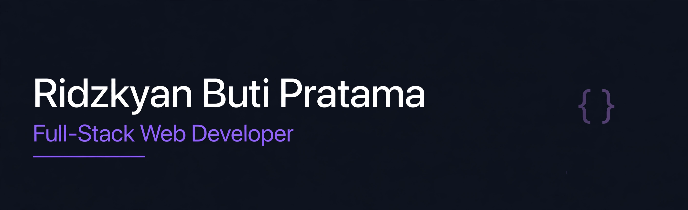

<div align="center">



<br/>

[](https://github.com/kianlabs?tab=followers)
[](https://kian.my.id)

</div>

---

## 👨‍💻 Tentang Aku

```javascript
const kian = {
  name     : "Ridzkyan Buti Pratama (Kyan)",
  location : "Kartasura, Sukoharjo 🇮🇩",
  education: "S1 Teknik Informatika — Universitas Duta Bangsa Surakarta (IPK 3,69) 🎓 — Skripsi: klasifikasi keuangan UMKM (Gaussian Naive Bayes)",
  role     : "Web Developer",
  stack    : ["TypeScript", "React", "Next.js", "JavaScript", "Tailwind CSS", "Laravel", "PHP", "Node.js", "FastAPI", "Python", "PostgreSQL", "MySQL", "Supabase", "Prisma", "SQLite", "Docker", "Git", "Vercel"],
  learning : ["Full Stack Development", "AI / Machine Learning"],
  focus    : "Production projects + solid backend fundamentals",
  status   : "🎓 Fresh graduate Okt 2026 — 🟢 Open to work as Backend / Fullstack Developer"
};
```

> Most of my recent work is in private client repositories — the projects below are my personal work.

---

## 🛠️ Tech Stack

<div align="center">

[](https://skillicons.dev)

**AI:** LLM API Integration · RAG · MCP · Prompt Engineering · AI Agent Orchestration

</div>

---

## 📊 GitHub Stats

<div align="center">


</div>

---

## 🚀 Featured Projects

<div align="center">

| 🗂️ Project | 📝 Deskripsi | 🛠️ Tech | 🔗 Link |
|------------|-------------|---------|---------|
| **Rahardjo Finance** | Finance & inventory web app for a coffee shop (client work): shift reports, stock, weighted-average HPP, P&L | React, TypeScript, Supabase | [→ Live](https://rahardjo-finance.pages.dev) |
| **Suro POS (coffee-shop-pos)** | Offline-first tablet POS for coffee shops: cashier, recipe-based stock, HPP per gram, Bluetooth printing | React, TypeScript, Capacitor, SQLite | [→ GitHub](https://github.com/kianlabs/coffee-shop-pos) |
| **UangKu (uangku)** | Personal finance tracker (production) + Google OAuth, category budgets, PDF/CSV export | Next.js, FastAPI, PostgreSQL, PWA | [→ Live](https://uangku-web.my.id) · [→ GitHub](https://github.com/kianlabs/uangku) |
| **GaweTracker** | Job discovery scraper realtime (Glints & JobStreet) & application tracker (Kanban) | Laravel, PHP, MySQL, Tailwind CSS | [→ Live](https://gawetracker.kianlabs.my.id) · [→ GitHub](https://github.com/kianlabs/gawetracker) |

</div>

---

## 🏅 Sertifikasi

- **Junior Web Programmer** — BNSP (Badan Nasional Sertifikasi Profesi), 2026
- **Belajar Dasar Cloud dan Gen AI di AWS** — Dicoding Indonesia, 2026
- **Spec-Driven Development dengan Kiro** — Dicoding Indonesia, 2026
- **Memulai Pemrograman dengan Python** — Dicoding Indonesia, 2026
- **Belajar Machine Learning untuk Pemula** — Dicoding Indonesia, 2026

---

## 🎯 Currently

- 🚀 Shipping client projects (Rahardjo Finance, Suro POS) while building backend fundamentals toward job-ready
- 💼 Open to Junior Backend / Fullstack Developer roles — on-site Jawa, full-remote elsewhere

---

## 📫 Connect with Me

<div align="center">

[](https://kian.my.id)
[](https://www.linkedin.com/in/ridzkyanbutipratama)
[](mailto:ridzkyan0504@gmail.com)
[](https://github.com/kianlabs)

📍 Kartasura, Sukoharjo — open to full-time Junior Backend / Fullstack roles.

</div>

---

<div align="center">


</div>
